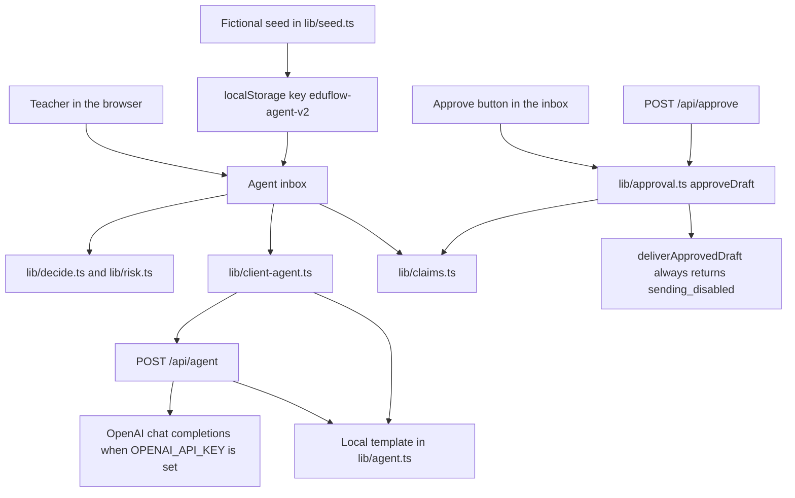

# Architecture

EduFlow Agent is a Next.js app. It drafts homework follow-ups for a teacher to review. It does not send them.

The Submission Guide PDF, read on 20 November 2026, defines an agent as one that pursues a goal by selecting steps, using relevant information or tools, and carrying out actions. The named steps are: Receive a goal, Determine steps, Use tools or data, Take action, Return a result. In this app those steps are the inbox trace from `lib/decide.ts`. The action that is actually carried out is writing a draft and stopping for a person. WhatsApp, email, and SMS are simulated and labeled. They are not carried out.

The 13-field Agent Card filled from these facts is in `SUBMISSION_READINESS.md`. Cost per task is not measured.

## Modules

| Piece | Role |
| --- | --- |
| `lib/seed.ts` | The only class record. Fictional schools, students, parents, and assignments. |
| `lib/store.tsx` | Loads and saves that record in the browser. Reset to demo scenario restores the seed. |
| `lib/risk.ts` | Calculates an experimental indicator from past-due fictional rows only. It is not a real assessment. A student who is back on time is not queued for a message. |
| `lib/decide.ts` | Turns that score into the visible goal, steps, data, decision, action, and result. |
| `lib/client-agent.ts` | Calls `POST /api/agent` and, on failure, shows the local template. |
| `lib/agent.ts` | Checks the request, calls OpenAI only when a server key exists, and otherwise fills the template. Model text is kept only when it stays on the supplied names and figures. |
| `lib/claims.ts` | Keyword and pattern guard. It blocks grade promises, school-policy language, unknown percentages, unknown phone numbers, letter grades, and another student's name. |
| `lib/draft-flow.ts` | Create, edit, reject, and approve a draft in memory. |
| `lib/approval.ts` | Shared approval rule for the page and the API. |
| `app/api/agent/route.ts` | Drafting only. |
| `app/api/approve/route.ts` | Approval only. The response always has `sent: false`. |
| `components/inbox.tsx` | The teacher prepares, edits, rejects, approves, or copies. |

## Data sources

- Fictional seed only. There is no school database and no real student data.
- Optional `OPENAI_API_KEY` on the server. The browser never receives the key. If the key is missing, the template is used.
- The reminder request sent to the server contains names, class, subject, assignment, due date, tone, and status. It does not contain the parent phone number (`lib/agent.ts`, `parseReminders`).
- Edits stay in `localStorage`. There is no login.

The weekly values 38, 46, and 52 in the seed are fictional story points. They are not rendered. On-time rates shown on the dashboard are counted from the fictional rows and labeled as demo data.

## Human approval

Two paths call the same function, `approveDraft`:

1. The inbox button **Approve this text**. It sends the text that is visible in the textarea, plus the role `teacher` from the page. That role is not a login.
2. `POST /api/approve`. The actor must be `teacher`. `agent` and `system` are refused with `teacher_approval_required`.

Before either path can mark a draft approved, `reviewTeacherEdit` must accept the text. Empty text, an unsupported claim, an unknown figure, or another student's name stays pending.

Copying writes to the clipboard. It does not call a delivery API.

## No-sending guarantee

`deliverApprovedDraft` returns `{ ok: false, sent: false, error: "sending_disabled" }` for every approved draft, including a draft that just passed the claims check. The approve API returns that same `sent: false`. There is no WhatsApp, email, or SMS client in the app. `tests/safety.test.ts` checks that application code does not reference a delivery endpoint.

A person can still paste copied text into another program. The product does not do that.

## Error handling

| Case | What the app does |
| --- | --- |
| The agent request exceeds 4 seconds (`AbortSignal.timeout`) or the browser is offline | `lib/client-agent.ts` maps that to `timeout` or `offline`, shows the local template, and labels it as a fallback. Nothing is sent. |
| The agent HTTP response is not OK, and it is not a 400 | The same local template is shown, labeled as a server fallback. |
| The agent HTTP response is 400 | No draft is created. A duplicate student id is reported as `duplicate_student_id`. Other bad bodies are `invalid_request`. |
| The model returns a fabricated claim, another person, or a figure that was not supplied | `lib/agent.ts` discards that text and uses the template. |
| The teacher types such a claim into the draft and presses approve | `lib/claims.ts` blocks approval. The draft stays pending. |
| The model key is missing or the call fails on the server | The route falls back to the template. |

The claims guard is a keyword and pattern list, not a full reading of the sentence. A paraphrase that avoids those patterns can pass. That limit is also stated in `docs/TEST_REPORT.md`.
